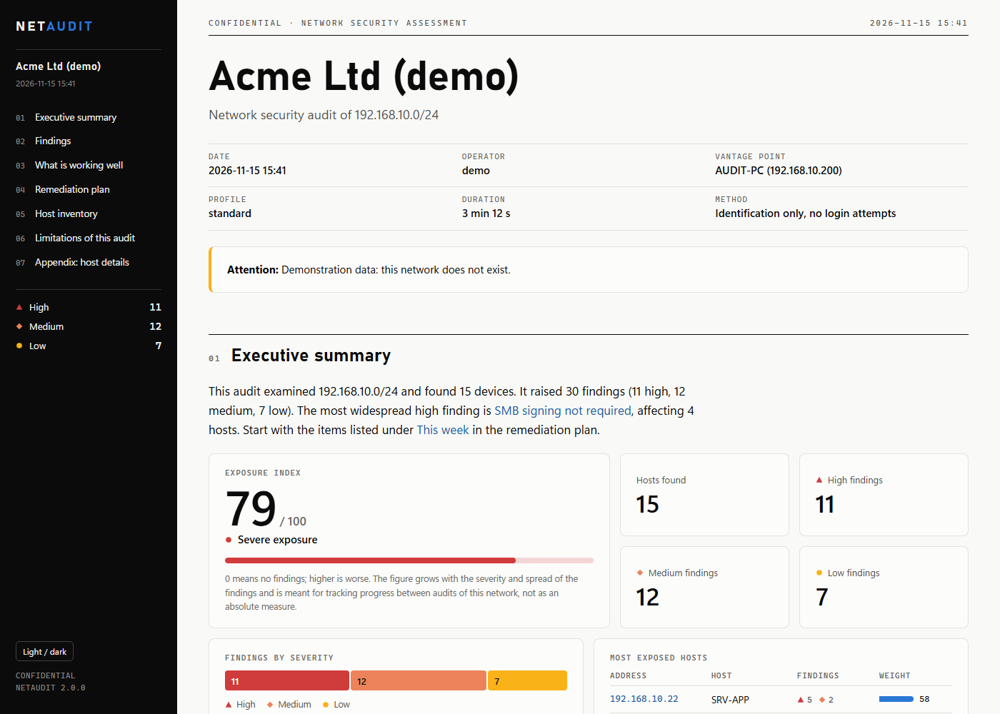
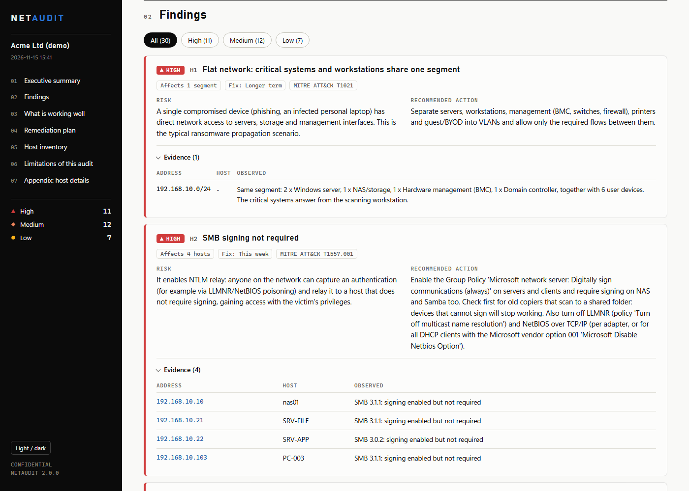
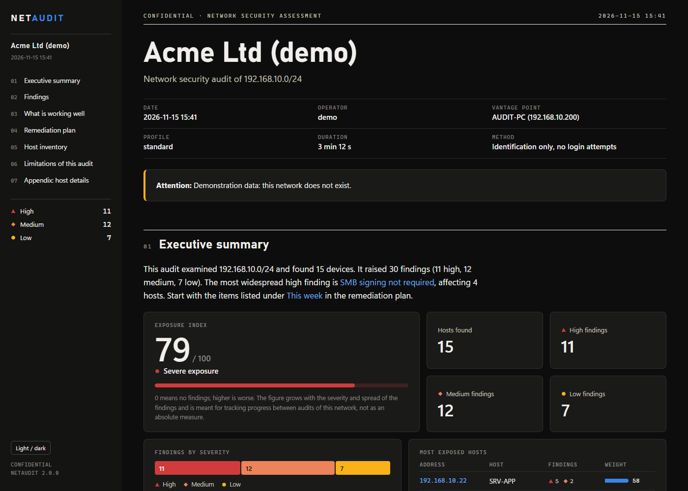
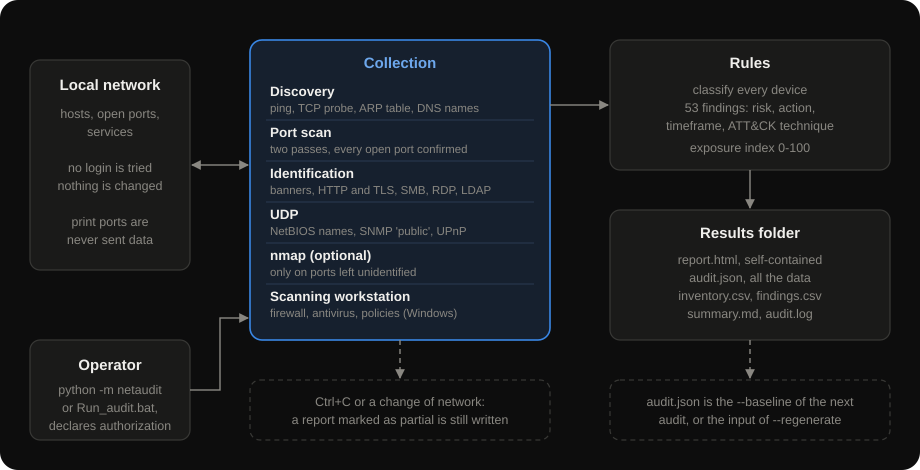

<p align="center">
  
</p>

NetAudit looks at a local network from one PC and writes down what it sees: the devices that are
switched on, their open ports and services, and the configurations that put the network at risk.
The result is one HTML file with priorities, a remediation plan and an inventory, written so that
it can be handed to a customer.

It only identifies. It never tries a password, never changes a setting and never sends data to a
print port. It needs Python and nothing else: no packages to install, no agent on the devices.

It was built and tried on one Windows PC. What was never tried is listed under
[Known limits](#known-limits).

**New here?** Go to [Run it, step by step](#run-it-step-by-step): it assumes you have never
opened a terminal. Before using it at a customer read
[Before you start at a customer](#before-you-start-at-a-customer), and
[If something goes wrong](#if-something-goes-wrong) lists the messages you may meet and what to do
about each.

> Everything is in English: the options, the terminal output, the report, the code comments and this document.

## Why use it

- **It is safe to point at an office network.** No login is attempted anywhere. Printers are
  recognized before they are probed and their print ports are never sent a byte, so nobody finds
  pages of garbage in the tray. The load is capped, and fragile devices can be left out.
- **The report is one file.** `report.html` has no external resources: it opens offline, prints
  cleanly, has a light and a dark theme, and can be attached to an e-mail as it is.
- **Every finding says what to do.** Each of the 53 findings comes with the risk in plain words,
  the recommended action, a timeframe and the MITRE ATT&CK technique. The full list is in
  [FINDINGS.md](FINDINGS.md).
- **It says what it did not see.** Every report has a section with its own limits: ports not
  checked, hosts that answered badly, phases that were skipped. Evidence that rests on a port
  number alone is marked as such.
- **The next audit shows what changed.** `audit.json` is kept and compared: new hosts, ports that
  opened or closed, findings that appeared or were resolved.
- **An interrupted audit is not lost.** Ctrl+C, a pulled cable or an unexpected error still give a
  report, clearly marked as partial.

What it costs is in [Known limits](#known-limits): it is an unauthenticated look from one point of
the network, so it measures no patch level and matches nothing against CVE databases.

## What it looks like

The pictures show the demo report, which describes a network that does not exist. `python -m
netaudit --demo` writes the same report on your PC without sending a packet.

<p align="center">
  
</p>

| Findings, each with risk, action and evidence | The same report in the dark theme |
|---|---|
|  |  |

The report has seven sections: an executive summary with an **exposure index** from 0 to 100, the
findings, what is working well, a remediation plan by timeframe, the host inventory (filterable and
sortable), the limitations of that audit, and an appendix with every port of every host. A "How to
read this report" box explains severity, timeframes and the index to a reader who is not a
technician.

The exposure index is a relative figure weighted by the severity and spread of the findings. Use it
to track progress between audits of the same network, not as an absolute measure or to compare
different clients. Findings about the PC that ran the audit do not count towards it.

## How it works



| Part | File | What it does |
|---|---|---|
| Command line | `netaudit/cli.py` | Options, the authorization question, the phases in order, the results folder, `--regenerate`, `--demo`. |
| Network facts | `netaudit/netinfo.py` | The PC's interfaces, the ARP table, targets as CIDR, single addresses or ranges. |
| Discovery | `netaudit/discovery.py` | Ping, a TCP probe for hosts that ignore ping, DNS names. |
| Port scan | `netaudit/portscan.py` | Connect-only scan in batches with a cap on open sockets; every open port is confirmed. |
| Probes | `netaudit/probes.py` | Banners, HTTP and TLS, SSH, VNC, SMB negotiation, RDP, LDAP rootDSE, Redis, product recognition. |
| UDP | `netaudit/udp.py` | NetBIOS names, one SNMP read with community `public`, UPnP/SSDP. |
| nmap | `netaudit/nmapx.py` | Optional: version detection on the ports the probes could not identify. |
| Workstation | `netaudit/localcheck.py` | Windows only: firewall, antivirus, updates, disk encryption and policies of the PC that runs the audit. |
| Knowledge | `netaudit/knowledge.py` | Ports and profiles, Windows builds with end-of-support dates, end-of-life server software, MAC vendors. |
| Rules | `netaudit/rules.py` | Device classification, the catalog of findings, positives, limits, the exposure index, the comparison between audits. |
| Report | `netaudit/report.py` | The HTML report, `summary.md` and the CSV files. |
| Demo | `netaudit/demo.py` | The fictional network behind `--demo` and the pictures of this page. |

## Legal use

Scanning networks without authorization is a criminal offense in most countries (in Italy: art.
615-ter of the Criminal Code). Use NetAudit only on networks you own or for which you hold a written
engagement. The tool asks for confirmation on every run, refuses public addresses unless explicitly
allowed, and records in the report who declared the authorization.

## Quick start

What you need:

| | |
|---|---|
| **A PC on the network to audit** | Windows 10 or 11. Tried on Windows 11 only. Linux and macOS are supported by the code but were never run. |
| **Python** | 3.9 or later, from python.org or with `winget install Python.Python.3.12`. Tried with 3.12 only. No Python packages are needed. |
| **Authorization** | The network is yours, or you hold a written engagement. |
| **nmap** | Optional. When it is installed it is used on the few ports the built-in probes cannot identify. |

For those who know a terminal, from the program folder:

```
python -m netaudit --demo                 a sample report for a fictional network, no traffic
python -m netaudit --self-test            the real pipeline against 127.0.0.1 only
python -m netaudit --client "Acme Ltd"    audit the subnet this PC is on, standard profile
```

### Run it, step by step

Written for someone who has never used a terminal.

1. **Install Python.** Download Python 3.12 from [python.org](https://www.python.org/downloads/windows/)
   and run the installer. On its first screen tick **Add python.exe to PATH**, then click
   *Install Now*.
2. **Download NetAudit.** On this page click the green **Code** button, then **Download ZIP**.
   Unzip it where you like, for example on the Desktop.
3. **Double-click `Run_audit.bat`** in the unzipped folder. A black window opens, says which
   network it is about to examine and asks you to confirm that you are authorized: type `YES` and
   press Enter.
4. **Wait.** The window shows what it is doing. When it has finished it prints where the report
   is: a `report.html` inside the `reports` folder, next to `Run_audit.bat`. Open it with a double
   click.

Without Python the window says so and tells where to get it.

To give any other command of this page, open the unzipped folder, click the address bar at the top
of the window, type `cmd` and press Enter: a black window opens in that folder. Type the command
there and press Enter.

### Before you start at a customer

- **Tell their IT or security team and agree a time window.** The audit pings every address, opens
  up to about 1,300 TCP connections per host (65,535 with the full profile), and reads banners, web
  pages and certificates. Intrusion detection and endpoint protection will probably raise alerts and
  may isolate the PC you run it from.
- **What runs on the PC**: on Windows it runs `ping`, `arp` and PowerShell (started with
  `-ExecutionPolicy Bypass -EncodedCommand`, which some security products flag) to read the network
  configuration and, unless `--no-local` is given, the PC's own security settings. If nmap is
  installed it also runs `nmap -sV` on the few ports it could not identify.
- **Run it from a PC that belongs to the network being audited.** That PC is checked too and its
  findings go into the report. If you run it from your own laptop, add `--no-local`, otherwise your
  laptop's settings appear in the customer's report.
- **Leave fragile equipment out**: put PLCs, medical devices and anything the customer is nervous
  about in `--exclude`.
- **Stay on the same network until it finishes.** If the PC changes network halfway the audit stops
  and the report is marked partial.
- **Treat the results as confidential.** They describe the internal attack surface of the network.

### Using it every day

```
python -m netaudit 192.168.1.0/24 --profile full --client "Acme Ltd"
python -m netaudit 10.0.0.0/24 10.0.1.10-50 --naming "^PC-\d+" --server-regex "^SRV"
python -m netaudit --config clients\acme.json
python -m netaudit --regenerate reports\Acme_Ltd_2026-11-15_1030
```

With no target it examines the subnet the PC is connected to (wired preferred over Wi-Fi, VPN and
virtual adapters ignored). Several subnets can be given in one run. Devices outside the PC's own
subnet are found by ping and TCP only (there is no ARP across a router), so for the most complete
picture run the audit from a PC on each segment.

**A configuration file per client.** Copy `client.example.json` to, say, `clients\acme.json`,
replace the `CHANGE-ME` values and run `python -m netaudit --config clients\acme.json`. Command-line
options win over the file, except that a `no-...` switch set to `true` in the file cannot be turned
back on from the command line. Use one `--client` name per site: `--baseline auto` compares with the
latest audit that has the same client name. The `clients` and `reports` folders are in `.gitignore`,
so they never end up in a repository by mistake.

**`--regenerate`** rebuilds findings and report from a saved `audit.json` (or its folder) with no
network traffic. It re-applies the `--naming`, `--server-regex` and `--domain` of the original run
unless you pass new ones, and redoes the comparison with the stored baseline.

**Install it as a command (optional).** From the program folder, `pip install .` adds a `netaudit`
command that works from any folder. Results are always written under the folder you run it from.
This was not tried.

### If something goes wrong

What is wrong is written in the black window. These are the messages you may meet and what to do.

| You read | What it means and what to do |
|---|---|
| `NetAudit needs Python 3.9 or later, and none was found.` | Python is missing, or *Add python.exe to PATH* was not ticked. Run the Python installer again and tick it. |
| `Python was not found` | The same, when you typed the command yourself: this is the message Windows gives. |
| `No local network detected: pass a target` | The PC has no usable network adapter (or only a VPN). Connect it, or give the network yourself: `python -m netaudit 192.168.1.0/24`. |
| `Invalid target or --exclude: ...` | A target is mistyped. Use `192.168.1.0/24`, `192.168.1.7` or `192.168.1.10-50`. Host names and IPv6 are not supported. |
| `One or more targets are not private addresses.` | NetAudit is for internal networks. If you really are authorized to examine public addresses add `--allow-public`. |
| `... addresses exceed the limit of 4096` | The target is very large. Narrow it, or raise `--max-addresses` if you mean it. |
| `Non-interactive run: add --authorized` | It was started by a scheduler or a script, where nobody can type `YES`. Add `--authorized`. |
| `Cannot use --baseline: ...` | The file given as previous audit is missing or is not an `audit.json`. Nothing was scanned: fix the path and repeat. |
| `Cannot write results to ...` | The results folder cannot be created there. Pass a folder you can write to with `--output`. |
| `the network changed during the scan` | The PC moved to another network (cable, Wi-Fi, VPN). The report is written but marked partial: repeat the audit staying connected. |
| `ran out of network sockets` (in the report) | The PC could not open connections fast enough and some open ports may have been missed. Repeat with `--speed careful`. |
| `The report could not be written ... saved to netaudit_rescue_...json` | The scan is not lost. Build the report with the `--regenerate` command printed right below the message. |
| `No previous audit found for this client: comparison skipped.` | Not an error: it is the first audit with that `--client` name. |

Exit codes, for scripts: `0` completed; `1` cancelled, interrupted (a partial report is still
written) or the results could not be written; `2` invalid arguments; `3` findings at or above
`--fail-on`.

### Updating and removing it

**Updating.** Download the ZIP again and replace the program files. Keep your `reports` and
`clients` folders: they hold your audits and your configurations. Updating this way was not tried.

**Removing.** NetAudit installs nothing. It writes in the `reports` folder next to the program (or
in the folder given with `--output`) and, only when a report cannot be written, a
`netaudit_rescue_...json` file in the folder you ran it from. Delete the NetAudit folder and nothing
is left. Python is a separate program and is removed from Windows' *Installed apps*.

### All options

| Option | Effect |
|---|---|
| `--client NAME` | name shown in the report and used for the results folder |
| `--profile quick`, `standard` or `full` | how many TCP ports are checked on each host: see [Profiles](#profiles) |
| `--speed careful`, `normal` or `fast` | `careful` for slow networks or fragile devices; `fast` for a reliable wired network only |
| `--naming REGEX` | naming convention of managed devices: PCs, Apple devices and unidentified devices whose name does not match are reported as not looking managed (servers, Linux hosts and infrastructure are not judged by name) |
| `--server-regex REGEX` | server names, to tell servers from PCs; it also marks Linux/Unix hosts as servers |
| `--domain NAME` | expected Active Directory domain (otherwise inferred from the majority of Windows hosts) |
| `--exclude LIST` | addresses that must not be touched: single IPs, CIDR blocks or ranges, comma separated |
| `--baseline FILE` or `auto` | previous `audit.json`: the report shows what changed. `auto` picks the latest audit of the same client under `reports` in the current folder |
| `--config FILE` | JSON file with the defaults for a client |
| `--regenerate FILE` | rebuild findings and report from a saved `audit.json` (or its folder), with no network traffic |
| `--fail-on LEVEL` | exit code 3 when findings of that severity or higher exist (for scheduled runs) |
| `--output FOLDER` | where to write the results (default `reports\<client>_<date>_<time>` under the current folder) |
| `--csv-delimiter comma` or `semicolon` | separator of the CSV files; `semicolon` opens directly in Excel where the list separator is `;` (most of continental Europe) |
| `--operator NAME` | who runs the audit (default: the current user) |
| `--authorized` | declare the authorization without the interactive question (for scheduled runs) |
| `--allow-public`, `--max-addresses N` | lift the two safety limits on targets |
| `--no-local` | do not check the PC the audit runs from (use it on your own laptop) |
| `--no-udp`, `--no-snmp`, `--no-ssdp`, `--no-nmap` | switch off individual phases |
| `--demo`, `--self-test`, `--catalog [FILE]` | the sample report, the run against 127.0.0.1, the findings reference. They cannot be combined with each other, with `--regenerate` or with targets |

`python -m netaudit --help` prints the same list.

## Profiles

| Profile | TCP ports per host | Time | Use it for |
|---|---|---|---|
| `quick` | 113 well-known ports | 1 to 2 minutes for 25 hosts, estimated | a first look, checking after a fix |
| `standard` | 1,253 (1-1024 plus common high ports) | about 3 minutes for 20 hosts | the periodic audit |
| `full` | all 65,535 | 30 to 40 minutes for 25 hosts, estimated | the first audit, an in-depth check |

Only `full` sees a service that listens on an unusual high port. The limitations section of every
report says how many ports were checked.

## What it checks

1. **Discovery**: ping, TCP probe for hosts that ignore ping and the ARP table find the hosts; DNS,
   NetBIOS and UPnP/SSDP then add names and descriptions to the hosts already found.
2. **Ports**: connect-only scan in batches, with every open port re-confirmed and a cross-check
   between passes.
3. **Services**: banners, HTTP/HTTPS (title, server, certificate, legacy TLS, Basic authentication,
   directory listings, end-of-life server software), SSH, Telnet, VNC, MySQL/MariaDB, Redis.
4. **Windows and SMB**: dialect up to 3.1.1, mandatory signing, SMBv1, real name, domain and system
   build.
5. **Remote Desktop**: whether Network Level Authentication is enforced.
6. **Active Directory**: the public rootDSE entry of LDAP servers (naming context, functional level).
7. **Scanning workstation** (Windows only): firewall, RDP/SMB rules per profile, antivirus, updates,
   disk encryption, UAC, WDigest, LSA protection, LLMNR, NetBIOS, listening ports, shares.
8. **Rules**: 53 findings (flat network, SMB signing, SMBv1, unsupported systems, exposed management
   interfaces, reachable databases, expired certificates, devices that do not look managed and
   more). `python -m netaudit --catalog FINDINGS.md` regenerates [FINDINGS.md](FINDINGS.md), and a
   test fails when that file is out of date.

## Results

In the results folder:

- `report.html`: the full report;
- `summary.md`: a short text summary for an e-mail or a ticket;
- `audit.json`: all the data, to be used as `--baseline` next time or with `--regenerate`;
- `inventory.csv` and `findings.csv`: for spreadsheets and ticketing. In `findings.csv` the `ID`
  column is the position in that report, while `Key` is stable across audits: match tickets on `Key`
  and `Address`;
- `audit.log`: the console log of the run.

A comparison between audits made with different profiles only looks at the ports both of them
checked, and the report says so.

## Probe safety rules

- **No login attempts**: credentials are never sent and passwords are never tried. The one exception
  is a read with the default SNMP community `public`, which `--no-snmp` switches off. The Windows
  identity check sends only the first, credential-free step of the SMB negotiation.
- **Printers**: nothing is ever sent to print ports (9100-9116, 515), which would otherwise print
  pages of characters; on printers, unknown ports are only listened to.
- **Limited load**: simultaneous connections are capped (720 at normal speed, 400 at careful). Above
  that the scan starts missing open ports.
- **Network change**: if the PC changes network during the scan (cable unplugged, switch to Wi-Fi)
  the audit stops and the report is marked as partial.
- **Cross-check**: ports found in the first pass must show up again in the second; inconsistent
  hosts are repeated at careful speed and, if still inconsistent, listed under the limitations. A
  host with more than 100 open ports (a tarpit or honeypot) has only its well-known ports
  identified, and each host has a five-minute budget for identification, so one device cannot stall
  the audit.
- **Interruptions**: an interrupted report is clearly marked, lists no reassurances, flags every
  host as partially covered and is not compared with the previous audit.
- **Untrusted input**: names, banners and descriptions come from the network. They are escaped in
  the HTML report and neutralized in the CSV files so a spreadsheet never runs them as formulas.

## Scheduling

To repeat the audit every month with Windows Task Scheduler, create a task whose action is the
Python program itself, not `Run_audit.bat`:

- Program: the full path of `python.exe` (the account the task runs as may not have Python on its
  PATH)
- Arguments: `-m netaudit --config clients\acme.json --authorized --fail-on high`
- Start in: the NetAudit folder

"Last Run Result" then shows `0x0` for a clean run and `0x3` when high findings exist. A scheduled
task was not tried.

## Tests

```
python -m unittest discover -s tests
```

The tests only use 127.0.0.1: small fake servers on the local PC exercise the scanner and the
probes, and sample data exercises the rules and the report. They cover target parsing, the port
scanner, every probe, printer safety, device classification, every group of findings, the report,
the CSV files, interrupted audits, the comparison between audits and the command line.

No certificate or key is stored in the repository. The fake TLS server of the tests makes a
throwaway self-signed certificate when the tests start, with the `openssl` program (the one that
comes with Git for Windows is found by itself). Without `openssl` the two TLS tests are skipped and
the others run as usual.

The pictures of this page are generated, so they can follow the code. `python tools/readme_art.py`
draws the banner and the diagram and takes the screenshots from the demo report with a headless
Chrome or Edge; it is a development tool only.

## Maintenance

- `netaudit/knowledge.py`: ports, profiles, the Windows release table with end-of-support dates and
  the list of end-of-life server software. **Review the dates at least twice a year.** They were
  last checked against Microsoft's release pages on 2026-11-15.
- `netaudit/rules.py`: the findings catalog (`CATALOG`) with title, risk, action, timeframe and
  ATT&CK id.
- `netaudit/probes.py`: product recognition (`_FINGERPRINTS`).

## Known limits

- It is an unauthenticated audit: it does not measure patch level or match software against CVE
  databases. Windows versions come from the build number reported over SMB, which identifies the
  family rather than the exact update.
- It only sees what is reachable from the PC that runs it: Internet exposure, other VLANs or sites
  and cloud services are not covered.
- IPv6 is not examined. UDP is limited to NetBIOS, SNMP and SSDP.
- Only devices switched on during the audit are seen.
- Evidence marked "by port number" is attributed from the port number alone and must be confirmed
  on the device.
- The check of the scanning workstation is Windows-only.
- Built and tried on one PC, with Windows 11 and Python 3.12. Linux and macOS, other Python
  versions, `pip install .` and a scheduled task were never tried. The times of the `quick` and
  `full` profiles are the program's own estimates.

## Credits

- [nmap](https://nmap.org/) is used, when installed, for the ports the built-in probes cannot
  identify. It is not part of this repository.
- [MITRE ATT&CK](https://attack.mitre.org/) is the knowledge base the technique codes of the
  findings refer to.

## Licence

NetAudit is released under the [MIT licence](LICENSE). That covers the code and the pictures in
this repository. It does not cover nmap, which is a separate program with its own licence.
